# From Content Consumption to Demonstrable Capability

<p align="center">
  
</p>

## The DeepCamp learning engine: designing a goal-driven AI system on top of 830,000+ free learning resources

**Author:** Samuel Iso — Founder & engineer, DeepCamp ([deepcamp.cc](https://deepcamp.cc)) · TechAssembly · Lagos, Nigeria  
**Version:** 1.0 — October 2026  
**Live product:** [deepcamp.cc](https://deepcamp.cc) · [Skill map](https://deepcamp.cc/skills) · [Jobs](https://deepcamp.cc/jobs) · [Reads](https://deepcamp.cc/reads)

---

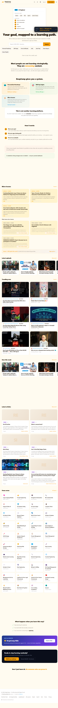

---

## Executive summary

Most online learning fails at a specific point: the moment content consumption is supposed to become capability. A learner watches a video, feels productive, and closes the tab — with no record of what they can now actually *do*, and no idea what to learn next. This report documents the design, architecture, and AI systems of **DeepCamp**, a working product built to close that gap.

DeepCamp organizes **832,140 lessons** from **260+ expert YouTube channels** and **70+ news/RSS sources** into a structured knowledge base, then layers a goal-driven learning engine on top: a four-level skill taxonomy, a per-user skill confidence model, a gap-analysis engine that turns a career goal ("AI Engineer", "Data Analyst") into a prioritized, content-backed learning path, an AI tutor that teaches from video transcripts, an AI mentor with a persistent syllabus, and a jobs module that maps real job postings to the exact lessons that close each skill gap.

The system is built by a solo founder on Cloudflare's serverless platform: **eight cooperating Workers**, a **77-migration D1 database**, **ten queues**, a **1024-dimensional vector index**, and a multi-model AI layer (Cloudflare Workers AI + AWS Bedrock) with explicit fallback chains, token budgets, and cost controls. Every AI feature is billable through an internal credit currency ("Sparks") with a 24/7 self-hosted ops control plane.

The report covers:

1. **The content supply chain** — how raw third-party videos become a queryable knowledge graph: ingestion, three-strategy transcript acquisition, and a **V3 Map/Reduce enrichment pipeline** that processes every character of every transcript (not a 2,000-character truncation) through an 8B "map" stage and a 70B "reduce" stage.
2. **The learning engine** — the skill gap engine's confidence model, roadmap generation, versioned AI tutor explainers, mentor mode, hybrid semantic search, and a Thompson-sampling recommendation feed.
3. **The jobs bridge** — how real job postings are ingested, AI-matched to a skill taxonomy, and converted into 14-step prep roadmaps.
4. **Production engineering** — the honest details: a $7,198/month D1 billing incident and its fix, a custom slot allocator for a 1-browser/second rendering quota, D1→R2 storage migration, self-healing queues, and a 658-test suite guarding a 21,000-line single-file worker.
5. **Evaluation** — a concrete methodology for measuring learning-path quality, with a runnable harness, published as part of this report.

> **Central research question.** *How can an AI system translate a person's career goal into a structured, measurable learning path — rather than simply recommending more content?*

---

## 1. The problem: watching is not learning

Self-taught learners — especially in emerging markets — face four compounding failures:

| Failure | What it looks like | Cost |
|---|---|---|
| **Unstructured supply** | 830k+ free videos exist for any career path; quality and order are random | Learners bounce between disconnected tutorials |
| **No capability model** | No system tracks *what you can now do* after watching | Learning is invisible to employers and to the learner |
| **No goal linkage** | Courses teach topics, not paths to a job | Learners can't answer "what do I study next, and why?" |
| **Jobs are the target, content is the tool** | Job postings list skills; learning platforms list videos | Nobody connects "this job needs X" → "here is how to learn X" |

The result is a generation of learners who *consume* AI content without *acquiring* AI skills — what the DeepCamp landing page calls the core problem: "Most people are not learning strategically. They are consuming content."

### 1.1 What "demonstrable capability" requires

Turning consumption into capability needs an explicit chain:

```
Goal → Required skills → Skill requirements → Current skill state → Gaps →
Ordered learning path → Content per step → Evidence of progress → Credential → Job readiness
```

Every stage of that chain must be represented in data, not in a course brochure. That representation — not any single AI feature — is the core design contribution of DeepCamp. The rest of this report describes the systems that implement and feed it.

---

## 2. Design thesis

Five principles drove the architecture:

1. **Structure first, compress later.** When converting video into knowledge, process the *whole* artifact before summarizing it. This principle (adopted after measuring that the original pipeline saw only 1.1% of a 4-hour video's transcript) produced the V3 Map/Reduce pipeline (§5.3).
2. **Users pay for AI and convenience, never for content.** Every raw video embed is free; the internal currency gates AI tutoring, roadmaps, and convenience features. Trust before monetization (§7).
3. **Mobile-first, low-bandwidth.** Users are on phones in Lagos, Nairobi, and Dhaka. The entire product is server-rendered HTML with no frontend framework, no bundler, and small payloads (§4.1).
4. **Every AI call has a budget, a fallback, and a cache.** Model fallback chains, token ceilings, generation locks, and content-addressed caching are first-class design elements (§4.4, §6.4).
5. **The platform is the ops team.** A solo founder cannot run servers; the architecture is serverless end-to-end, with a 13-page admin control plane replacing a DevOps department (§5.6).

---

## 3. Prior art and differentiation

| Approach | Examples | What it solves | What it misses |
|---|---|---|---|
| Course platforms | Coursera, Udemy | Curated, sequenced content | Content is closed and static; no per-user skill state; expensive in target markets |
| Video aggregation | YouTube (algorithmic), RSS directories | Free supply | Optimizes watch time, not capability; no skill model |
| AI tutors | Khanmigo, ChatGPT study mode | Conversation-quality teaching | No persistent skill graph, no content library, no employer-facing evidence |
| Skill taxonomies | LinkedIn Skills, O*NET | Shared vocabulary | Not connected to learning content or job postings in one loop |
| Job boards | LinkedIn, Remotive | Demand signal | No learning response to the demand signal |

DeepCamp's differentiation is the **closed loop**: job demand → skill requirements → skill gap → ordered path → free content → confidence updates → verifiable credential → better job matching. Each link is a working subsystem in production, not a roadmap slide.

---

## 4. System architecture

### 4.1 Platform choice

DeepCamp runs entirely on Cloudflare's serverless stack. For a solo founder in Nigeria, this choice is load-bearing:

- **No servers.** Eight Workers, 77 database migrations, ten queues, and two AI providers are all managed services.
- **Edge delivery.** Server-rendered HTML from 300+ edge locations matters for the target audience's networks.
- **Cost shape.** Spend scales with usage; the platform's free tiers covered the first year of operation.

### 4.2 The eight services

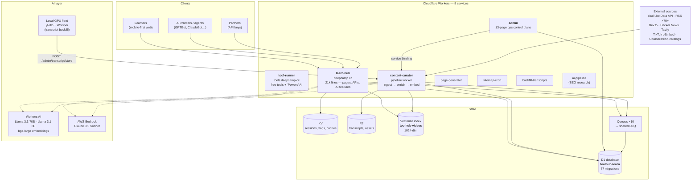

| Worker | Role | Size | Notable |
|---|---|---|---|
| **learn-hub** (`toolhub-learn`) | The product: all pages, APIs, AI features, sitemaps, auth, payments, email | ~21,000 lines, single file | Server-rendered HTML; 67 test files, ~658 tests |
| **content-curator** (`toolhub-content-curator`) | The factory: ingestion, transcripts, V3 enrichment, embeddings, micro-lessons | ~8,300 lines | Hourly cron + 10 queue consumers |
| **admin** (`toolhub-admin`) | Ops control plane: pipeline seeding, monitoring, user/credit ops, SQL runner | ~6,300 lines | Service binding to curator; SHA-256/KV session auth |
| **tool-runner** (`toolhub-tool-runner`) | Free tools site (`tools.deepcamp.cc`) sharing the same accounts; paid "Powers" AI via Bedrock Claude Haiku | — | Streaming SigV4 response parser |
| **page-generator** / **sitemap-cron** / **ai-pipeline** / **backfill-transcripts** | Legacy tool-site machinery kept alive; sitemap ping; SEO research; legacy transcript receiver | small | Scheduled for retirement |

The legacy tool site that started this codebase still runs — the product grew out of it rather than being rebuilt, which is itself an honest artifact of solo-founder evolution.

### 4.3 Data model

A single D1 SQLite database (`toolhub-learn`) with **77 numbered migrations**. Raw SQL only — no ORM. Key tables:

| Domain | Tables | Purpose |
|---|---|---|
| Content | `videos`, `news`, `channels`, `topics`, `video_topics`, `alt_video_sources`, `news_sources` | 830k+ videos, 2.4k+ articles, 260+ channels, 39 topics |
| Enrichment | `transcript_chunks`, `chunk_extractions`, `video_skill_map`, `site_stats` | V3 Map/Reduce artifacts; video→skill mappings; precomputed counters |
| Transcripts | `videos.transcript / transcript_r2_key`, `browser_render_lock` | Text in R2, 1-browser/sec slot allocator |
| Users | `users`, `subscriptions`, `user_roadmaps`, `collections`, `saved_videos` | Accounts, Pro plans, roadmaps, playlists |
| Skills | `user_skill_profile`, `goal_skill_requirements`, `user_skill_goals`, `user_skill_gaps`, `user_skill_overrides` | The skill-state model (§6.1–6.2) |
| Tutor/Mentor | `video_explainers` (versioned), `video_explainer_feedback`, `explainer_generation_locks`, `mentor_syllabus`, `mentor_modules`, `mentor_progress`, `mentor_memory`, `content_calendar` | AI teaching artifacts |
| Jobs | `jobs`, `job_skills`, `job_missing_skills`, `job_lessons`, `jobs_page_cache`, `job_fetch_logs` | The demand signal (§6.8) |
| Engagement | `user_engagement`, `user_topic_progress`, `topic_thompson`, `user_milestones`, `leaderboard_weekly_scores` | Recommendation + retention signals |
| Economy | `spark_spends`, `admin_spark_issues`, `credit_purchases`, `chat_usage`, `roadmap_usage` | The credit currency (§7) |
| Email | `email_preferences`, `email_queue`, `user_email_log`, `email_consent_history` | Consent-first engagement engine |

### 4.4 The AI model registry

| Purpose | Model | Notes |
|---|---|---|
| Content enrichment "reduce", micro-lessons, AI chat, job matching | `@cf/meta/llama-3.3-70b-instruct-fp8-fast` | The workhorse; JSON-structured outputs |
| Transcript chunk "map", classification, query suggestions | `@cf/meta/llama-3.1-8b-instruct` | Cheap extraction at scale |
| Embeddings (index + query) | `@cf/baai/bge-large-en-v1.5` | 1024-dim; identical model for index and query |
| Tutor explainers, roadmap generation | `us.anthropic.claude-3-5-sonnet-20241022-v2:0` (Bedrock) | Fallbacks: older Sonnet → Opus → Haiku |
| LLM fallback chain (all features) | `@cf/zai-org/glm-5.2` → `@cf/moonshotai/kimi-k2.6` → `llama-3.3-70b` | Graceful degradation on 429/5xx |
| News topic classification | `@cf/meta/llama-3.1-8b-instruct-fast` | 20-token outputs |

Two provider tiers by design: **Workers AI for volume** (thousands of enrichment calls/hour) and **Bedrock Claude for quality-critical generation** (tutor, roadmaps), each with explicit cross-provider fallback.

---

## 5. The content supply chain

This section is the first half of the answer to the central question: **the learning engine is only as good as the structured data underneath it.** A skill-gap engine that recommends from title strings alone would be useless. Roughly half of the system's engineering exists to turn raw video into structured, skill-tagged, transcript-backed knowledge.

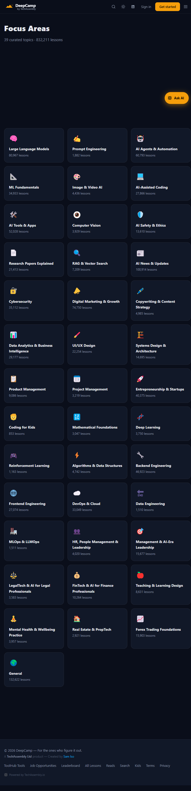
*39 focus areas covering 832,140 lessons — the largest single topic, Large Language Models, holds 80,943 lessons.*

### 5.1 Ingestion

The curator worker runs an hourly pipeline (`0 * * * *` plus dedicated sub-crons for news and micro-lessons):

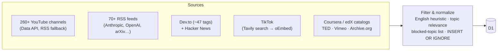

- **YouTube:** channels are polled via the Data API (uploads playlists, 50/page); when API quota runs out, the pipeline falls back to channel RSS feeds. A discovery queue lets the app itself request "more videos like this channel" (`/api/discover-related` writes sentinel rows the curator processes).
- **News:** 50 rotating RSS sources per run (subrequest budget management), plus Dev.to and Hacker News (points > 10).
- **TikTok:** because TikTok has no commercial research API, discovery runs a **Tavily web search** for `site:tiktok.com <keyword>` against a persistent, AI-refined query library, hydrates each URL via public oEmbed, and processes results through a queue. Heavy crawling deliberately runs in local scripts, not in Workers, to stay inside free API limits.
- **Deduplication & quality:** every insert is `INSERT OR IGNORE` with deterministic IDs (`yt_<videoId>`, `news_<hash(url)>`); heuristic English scoring and a blocked-topic list keep corpus quality usable.

### 5.2 Transcript acquisition — three strategies and a slot allocator

Transcripts are the raw material for everything downstream. YouTube captions are gated aggressively, so the system uses three escalating strategies:

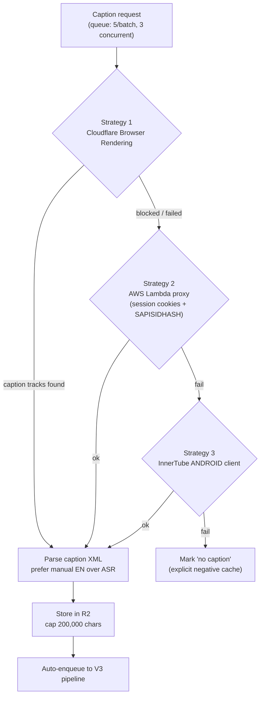

Two production details worth highlighting:

1. **The browser-render slot lock.** Cloudflare Browser Rendering allows ~1 new browser per second. Rather than discovering this via rate-limit errors, the system implements an atomic slot allocator (`browser_render_lock` table, launch interval 1,100ms) so N concurrent workers self-organize into a ≤1/sec launch rate.
2. **Off-platform transcript fleet.** Workers cannot run `yt-dlp`. For the historical corpus (~176k videos), local scripts drive a yt-dlp fleet (~3,800 transcripts/hour; json3 subtitle format compresses ~20:1 to plain text) and POST results to `POST /admin/transcript/store`, which persists to R2 and auto-enqueues V3 enrichment. TikTok audio is transcribed with a local **Whisper** deployment through the same endpoint.

A background cron (every 2 minutes) continuously migrates transcript text out of D1 into R2, reclaiming database storage — database rows hold only a pointer (`transcript_r2_key`).

### 5.3 The V3 Map/Reduce enrichment pipeline

The original pipeline truncated transcripts to 2,000 characters before sending them to a 70B model — meaning a 4-hour video (~180k characters) was enriched from **1.1% of its content**. V3 replaced this with a full-coverage Map/Reduce architecture operating on the principle *structure first, compress later*:

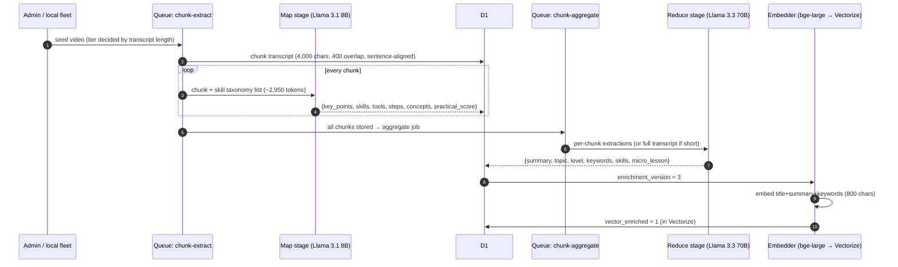

**Tiering** (decided at seed time by transcript length): *short* ≤ 8k chars goes straight to the 70B reduce with the full transcript; *medium* (8k–50k) and *long* (50k+) are chunked. The state machine (`v3_state`: `chunked → mapped → reduced`) is tracked per video with progress counters, enabling the admin dashboard to show live pipeline state and to reset stuck items.

**Token budgets** were designed, not discovered:

| Stage | Input budget | Output cap | Context safety |
|---|---|---|---|
| 8B map (per chunk) | ~2,950 tokens (system + taxonomy + 4k-char chunk) | 800 | safe for 8k context |
| 70B reduce (chunked) | ~4,900 tokens (14 × ~50-token extractions) | 2,048 | safe |
| 70B reduce (short) | ~7,200 tokens (full ≤12k-char transcript) | 2,048 | safe |

**Throughput:** map ≈ 3.6 videos/sec (full corpus ≈ 6 hours at concurrency 20), reduce ≈ 7.5 videos/sec — the map stage is the bottleneck by design, since it reads everything.

**What the reduce stage produces** — the structured record that the learning engine actually consumes: a ≤500-char summary, topic assignment with confidence (validated against the 39-topic taxonomy), level, ≤15 keywords, ≤6 concepts, ≤5 skills (validated against the skill graph), and a full **micro-lesson** (TL;DR, 5–10 steps, tools, key insight, prerequisites, practical score). Skill IDs that the model hallucinates are dropped by validation against the taxonomy — the model suggests, the catalogue disposes.

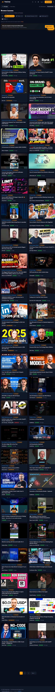
*Every lesson card in the product is backed by this enrichment record — summary, topic, level, and skills.*

### 5.4 Embedding and vector search

Enriched content is embedded with `@cf/baai/bge-large-en-v1.5` (1024 dimensions) from an 800-character distilled text (title + summary + keywords + concepts), upserted into the `toolhub-videos` Vectorize index (IDs truncated to Vectorize's 64-byte limit), with topic/level metadata for filtered queries. A reconciliation endpoint audits D1 state against `Vectorize.getByIds` and repairs drift. Concurrency engineering took bulk (re-)embedding from ~1 video/7s (~97 hours for 50k videos) to ~9 videos/sec (~90 minutes) via batched sub-waves with per-sub-batch ack/retry.

### 5.5 Micro-lessons for news

News articles follow a parallel path: Jina Reader extracts full text, a 70B call produces a structured micro-lesson (TL;DR, 4–6 action-verb steps, key insight, tools, careers, skills), with quality gates that reject filler steps and generic summaries, and an explicit `"skip"` signal for off-topic articles. Lessons land on AMP pages (`/reads/:slug/amp`) and in the Read feed:

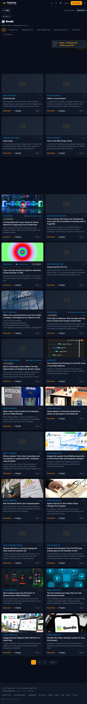

### 5.6 The ops control plane

A 13-page admin dashboard (`workers/admin`) is the human interface to all of the above: pipeline stage bars (chunking / mapped / reduced / pending), one-click seeding of any pipeline stage with live 8-second polling, a semantic-search test harness, a raw SQL runner, pause flags for all 9 subsystems, user/credit operations with audit trails, and bank-transfer approval. It proxies heavy operations to the curator worker over a service binding — the admin worker never does AI work itself.

---

## 6. The learning engine

This section is the second half of the answer to the central question: what the product does with structured knowledge.

### 6.1 The skill taxonomy

A four-level hierarchy maintained as code (reviewable, versioned, test-validated):

| Level | Count | Example |
|---|---|---|
| Domain | 8 | AI & ML, Software, Data, DevOps, Business, Design, Tools, Kids |
| Cluster | 31 | `llms`, `prompt-engineering`, `ai-agents`, `data-analytics`… |
| Skill | ~129 | "RAG pipeline design", "Prompt evaluation", "Vector databases" |
| Unit | keyword-tagged | The strings that match video titles/descriptions/keywords |

Plus **27 career goal templates** (LLM Engineer, Data Analyst, Product Manager…) — each a weighted set of required skills with minimum confidence thresholds, prerequisite chains, and importance weights (1 = blocking).

### 6.2 The skill gap engine

The heart of the product. Each user accumulates **skill confidence** (0.0–1.0) from three sources — inferred from watch history, self-rated, or earned via project completion — with passive watching deliberately worth half credit:

```
conf = log10(hours + 1) × 0.4 × qualityMult × levelDiscount × weight × 5
qualityMult    = 0.5 + avgCompletion × 0.5      (passive watching gets 50%)
levelDiscount  = beginner 1.0 · intermediate 0.7 · advanced 0.4
```

Real-time deltas apply on every engagement (`≥80% completion → +0.08 × relevance × rank multiplier`), so the skill state is *live*, not a nightly batch.

Given a goal, the engine computes and caches (60-minute TTL) a prioritized gap list and learning path:

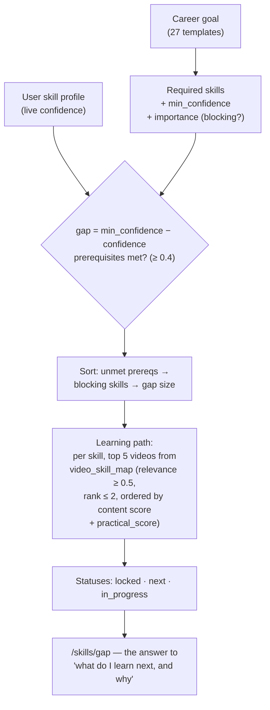

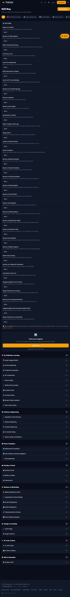
*The skill map: 40+ goal cards on top, the full domain → cluster → skill tree below, with live confidence bars.*

The gap computation itself is deterministic and explainable — no LLM in the loop — which is deliberate: **AI is used where judgment helps (understanding content) and avoided where determinism helps (measuring you).** When a user sets a goal, gaps render instantly from cached state; the AI-generated artifacts (roadmaps, explainers) hang off this deterministic skeleton.

### 6.3 Roadmap generation

`POST /api/roadmap/generate` (streamed over SSE) uses Bedrock Claude with the full Workers-AI fallback chain behind it. The prompt enforces **exactly five phases**, each with a focus and 4–5 *specific YouTube search queries* — roadmaps resolve to real content through the search/indexing layer, and channel steering (per-career channel quality lists) keeps beginners away from 3-hour conference talks. One free roadmap/month, then 50 Sparks. Stored as a JSON blob; the post-generation flow drops the user directly into lesson one ("your roadmap is ready — start here").

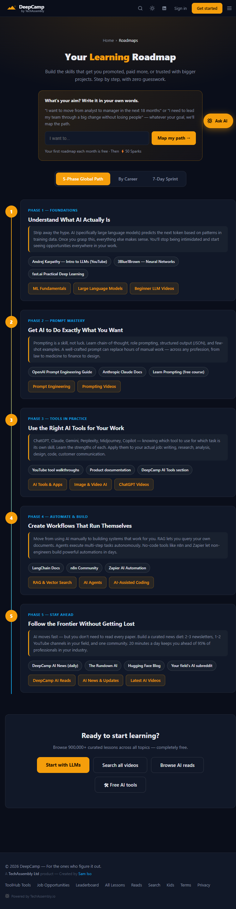

### 6.4 The AI tutor: versioned, cached, locked, billable

Every lesson page can generate an **explainer** — a Claude-written, transcript-grounded teaching of that specific video, streamed token-by-token over SSE. This is the most engineered AI feature in the system:

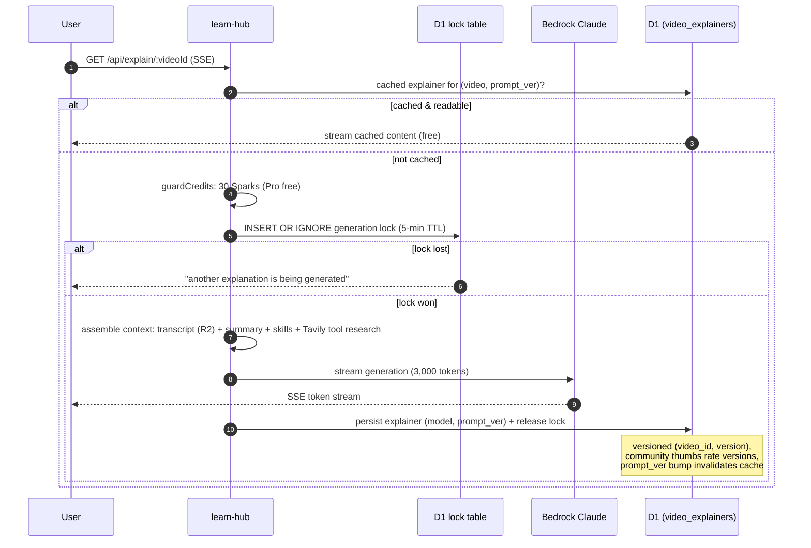

Design decisions worth noting:

- **Never charge for an unready lesson** — if no transcript exists, the API returns `422 transcript_not_ready` before any billing.
- **Reading someone's cached explainer is free**; you pay only to generate. A versioned store (`(video_id, version)` primary key, `is_best` flag, community ratings) turns one user's payment into a permanent public good — cost amortizes toward zero as coverage grows.
- **A D1-row generation lock** (5-minute TTL, stale-lock cleanup, double-check-after-lock) prevents double-billing across concurrent requests and edge PoPs.
- Explainers feed the leaderboard (+15 points) and count toward skill confidence.

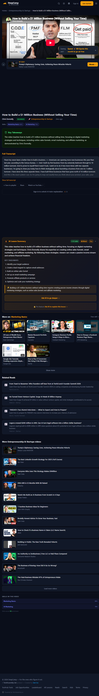

### 6.5 Mentor mode: a persistent syllabus

Chat alone doesn't produce structure, so DeepCamp gives the AI **a syllabus to be accountable to**: `mentor_syllabus` → ordered `mentor_modules` (each tied to concrete video IDs) → `mentor_progress` (one active syllabus pointer per user) → `mentor_memory` (chat history tagged by intent) → `content_calendar` (scheduled nudges: start, streak-risk, revival, certificate-ready). Chat intent classification injects the current module into context, and a small state machine advances modules on "done/skip" signals. Free users get 3 chats/day; guests get 1 — tracked server-side, not by client state.

### 6.6 Semantic search with an honest quota

Search is hybrid: a `bge-large` embedding of the query (cached by content hash for 30 days) against Vectorize (topK 200 for videos, threshold 0.55, metadata-filtered), fused with keyword ranking, with a SQL `LIKE` fallback on any Vectorize failure — search never hard-fails. The cost side is made visible to users rather than hidden:

- 2 semantic searches/day free for signed-in users, then **1 Spark**, with the UI explaining the difference ("understands meaning, not just keywords") and a toggle to opt down to plain keyword search.
- Unauthenticated users get keyword search plus a visible upsell.

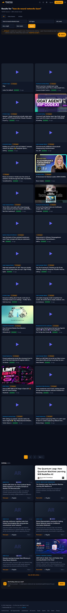
*Hybrid search: "how do neural networks learn" surfaces relevant lessons across 163k+ indexed candidates.*

### 6.7 The recommendation feed: exploration by design

The feed (a TikTok-style vertical swipe surface) is a multi-signal scorer with an explicit anti-filter-bubble budget:

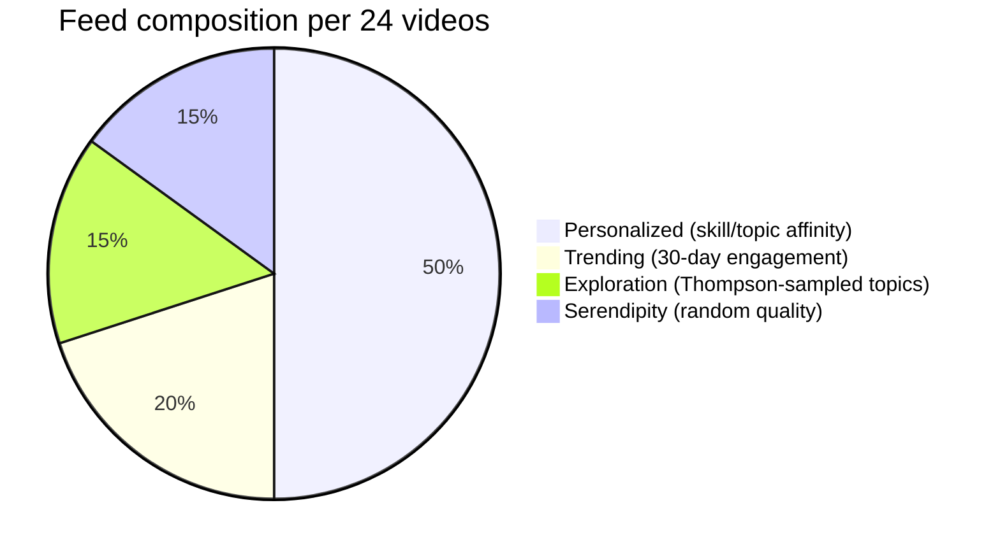

- **Thompson sampling** over topic arms (Beta posteriors updated by watch completion, shares, and skips) drives exploration — the system *spends* 15% of every feed measuring topics the user hasn't tried, and publishes its arms at `/api/thompson-arms`.
- Diversity rules cap any topic at 30% of a feed, interleave to prevent >3 consecutive same-topic cards, and pair primary topics with curated supporting topics (e.g. `llms` pairs with `rag-search`, `prompt-engineering`).
- Cold start (fewer than 5 watch events) blends popular-recent, fresh, and cross-topic samples instead of personalizing on nothing.

### 6.8 The jobs bridge: demand signal in, learning path out

The jobs module closes the loop from labor market to curriculum:

```mermaid
flowchart LR
    subgraph FETCH["Daily fetch (cron)"]
        S1["AdZuna"] & S2["Remotive"] & S3["RemoteOK"] & S4["Arbeitnow"] & S5["WeWorkRemotely"]
    end
    K["Keyword classification<br/>vs skill graph (focus area, skills)"]
    AI["Ambiguous jobs → 70B AI matcher<br/>(batched: focus area, ≤6 skills,<br/>≤5 missing skills, validated)"]
    ES["English-score heuristic<br/>(0.5 threshold, region boosts)"]
    JL["Materialize job_lessons:<br/>≤14 scored lessons per job<br/>(relevance .45 + practical .35 + popularity .08)"]
    PR["Prep roadmap:<br/>Foundation → Build & apply → Polish & interview"]
    FETCH --> K --> AI --> ES --> JL --> PR
```

Every job page shows the matched skills, the missing skills as learning targets, and a 14-step prep roadmap assembled from the same content graph — and completed skills feed back into the user's profile that matching uses.

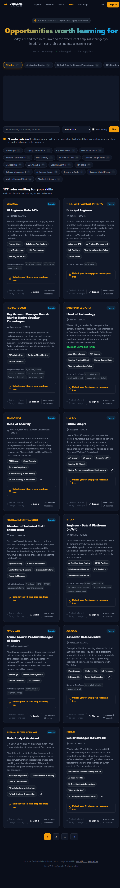
*Jobs matched to a skill profile, with one-click prep roadmaps.*

### 6.9 Evidence: credentials, portfolios, report cards

Capability must be *demonstrable* to matter. Skills at ≥0.8 confidence issue **verifiable skill credentials** (public verification pages, shareable SVG cards, LinkedIn-linked proofs); every user gets a public progress report card (`/report/:username`, download-as-image) and a portfolio subdomain (`username.deepcamp.cc`) with a Partner API (`/api/v1/...`, key-authenticated) for external consumers. These artifacts double as the product's organic growth loop.

### 6.10 The retention engine

Learning products die from silence, not missing features. A consent-first email engine (Resend, batched 100/queue job, JWT-signed unsubscribe links) runs weekly digests, milestone celebrations, and a staged re-engagement ladder (3d → 7d → 14d → 30d inactive) with hard caps of one marketing email per 24h. A weekly leaderboard with 5%-per-missed-day decay, streak multipliers, a 90-min/day watch cap (deliberately anti-addiction), and farming-account detection rounds out the engagement layer.

---

## 7. The economy layer: Sparks

All AI features share one currency. 1 Spark ≈ ₦50 (Nigerian Naira); Pro is ₦5,000/month (or $9 international). The price of each feature was set against its *actual* inference cost:

| Action | Cost | Rationale |
|---|---|---|
| Generate AI explainer | 30 Sparks (~₦1,500) | ~₦170 real Bedrock cost when uncached → ~89% margin; ₦0 when reading someone's cached explainer |
| Generate roadmap | 50 Sparks (~₦2,500) | ~97% margin over ~₦86 Bedrock cost |
| New skill goal | 24 Sparks | Deterministic computation, moderate value |
| Extra semantic search (beyond 2/day) | 1 Spark | Marginal embed-call cost |
| Extra save / playlist | 1 / 5 Sparks | Convenience, not content |
| Ad-free month | 100 Sparks spend | Ads only for free-tier users |

Three rules keep the economy honest: **content is never gated** (every video embed is free — Sparks buy AI and convenience); **every spend is logged** (`spark_spends` with reason codes feeding the ad-free calculation); and **allowances are visible** (free quotas for roadmaps, chats, saves, and searches are stated in the UI, not hidden behind surprise charges).

---

## 8. Evaluation

A report is only as good as its honesty about what has and hasn't been measured. Full methodology, rubric, and a runnable harness are in [docs/EVALUATION.md](docs/EVALUATION.md); the summary:

**Measured and shipped** (production evidence):
- Pipeline correctness: per-stage counters and state machines are queryable; invariant tests assert `v3Done + v3InFlight + v3Pending === withTranscript` with no gaps or overlaps.
- A 658-case test suite (67 files) guards the learning engine's domain logic — including 53 tests on the skill gap engine, search-fallback behavior, and cost-regression tests that *forbid* re-introducing query patterns that caused a real $7,198/month billing incident (§9).

**Evaluation harness, results pending** (this is the next two weeks of work, published openly):
- **Learning-path quality:** for a fixed battery of career goals, measure (a) skill relevance of recommended lessons, (b) ordering sanity (prerequisites before dependents), (c) coverage of required skills, (d) faithfulness of AI summaries to source transcripts. The harness (`evaluation/run-skill-gap-eval.mjs`) runs the real `/api/skills/gap` flow and scores outputs against the rubric.
- **Retrieval quality:** graded relevance for a fixed query set against the hybrid search, with keyword-only as baseline.
- **Explainer faithfulness:** sampled explainers checked for claims not supported by the transcript.

Interim numbers and the filled rubric will be published in this repository as v1.1 of this report. What is *not* claimed yet, deliberately: outcome improvements (job placement, skill retention over time) — those require cohort tracking that is being instrumented now, and this report will not fabricate them in the meantime.

---

## 9. Production engineering: the honest parts

### 9.1 The $7,198/month database bill

D1 billing is per-row-read. Three patterns were quietly reading millions of rows: missing indexes on `micro_lesson` / `vector_enriched` columns, full-table-scan `SUM(CASE WHEN…)` status queries, and redundant reads inside queue consumers. The fix — composite indexes (migrations 0041/0042/0076), a single precomputed `site_stats` counters row updated only by pipeline runs, primary/replica session splitting (`first-primary` for writes, `first-unconstrained` for queue reads), and **tests that forbid the expensive query patterns from returning** — turned the pattern into an engineering invariant rather than a memo.

### 9.2 Self-healing queues

Ten queues share one dead-letter queue, with per-sub-batch ack/retry (one poisoned item doesn't kill a batch), elevated retries on the expensive reduce stage (10 retries, 5-minute delay), hourly cron reconciliation that re-enqueues stuck states (`vector_enriched=2 → re-embed`, `=3 → re-enrich`, V3 `reset-stuck`), and a global pause system (9 flags, KV-shared across workers) that lets a solo operator stop any subsystem without deploys.

### 9.3 Serving at the edge without a frontend framework

The entire product is server-rendered HTML from a single worker — no React, no bundler, no hydration. The tradeoff is explicit: a 21,000-line `index.ts` is the cost of zero build infrastructure, mitigated by a 658-test suite, a JS-in-HTML syntax linter wired into the deploy hook, and a strict "new features go in modules, not inline" convention. For the audience (low-end Android, intermittent networks), first-render-from-HTML beats any SPA on meaningful metrics.

### 9.4 SEO as architecture

Sitemaps are segmented (5,000 URLs/file, index built from precomputed counters — never `COUNT(*)`), machine-readable `llms.txt` and a dedicated AI-crawler surface (`tollbit.deepcamp.cc`) monetize agent traffic explicitly, AMP variants serve news, and engine pings fire only when new content landed.

---

## 10. Limitations

Stated plainly:

1. **Single-founder bus factor of one**, concentrated in one 21k-line file — mitigated by tests and module conventions, not solved.
2. **Evaluation is young.** The retrieval and path-quality harnesses exist; full results are pending publication (§8). Nothing in this report should be read as a claim of measured learning outcomes.
3. **English-first.** The corpus and all heuristics assume English; multilingual support is unsolved.
4. **Skill confidence is a model, not ground truth.** Watch-derived confidence measures engagement with relevant content, not ability. The credential threshold (0.8) and employer-facing profiles are honest about being *evidence of study*, not proctored assessment — project-based verification is the planned upgrade.
5. **Monolith worker.** The learn-hub worker's size pushes against maintainability before it pushes against platform limits; decomposition is ongoing (jobs, email, TikTok, partner API are already modules).
6. **Legacy overlap.** Four workers (page-generator, sitemap-cron, ai-pipeline, backfill-transcripts) are tool-site-era machinery kept alive for historical routes; retirement is scheduled but undone.

---

## 11. Roadmap

1. **Evaluation v1.1** — publish the path-quality and retrieval rubrics with results (§8).
2. **Project-based capability evidence** — portfolio artifacts reviewed by AI rubrics, feeding credentials beyond watch-derived confidence.
3. **Cohort outcome tracking** — job-application → interview → offer events joined to skill gaps closed.
4. **Multilingual paths** — starting with French and Portuguese for West African markets.
5. **Partner API expansion** — employers and bootcamps consuming skill-verified candidate profiles directly.
6. **Decompose the monolith** — extract the remaining feature domains into modules with independent test surfaces.

---

## Appendices

- **[docs/APPENDIX.md](docs/APPENDIX.md)** — complete queue inventory, admin/ops endpoint map, D1 migration index, and external-service registry.
- **[docs/EVALUATION.md](docs/EVALUATION.md)** — evaluation methodology, rubric, and protocol.
- **[evaluation/run-skill-gap-eval.mjs](evaluation/run-skill-gap-eval.mjs)** — runnable evaluation harness.
- **[scripts/capture-screenshots.mjs](scripts/capture-screenshots.mjs)** — the script that captured the product screenshots in this report.

## Reproducibility notes

- All screenshots in this report were captured from production (`deepcamp.cc`) on **23 October 2026** with the script in `scripts/`.
- Figures quoted as "live" (832,140 lessons; 39 topics; 2,403 articles) come from public pages on that date and will drift as the pipeline runs — that drift is the system working.
- Source code is proprietary; this report is the architecture disclosure. Selected domain modules (skill graph catalogue, job-source adapters) may be extracted for public release.
